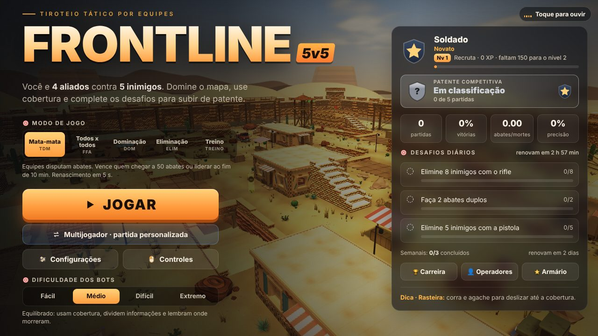
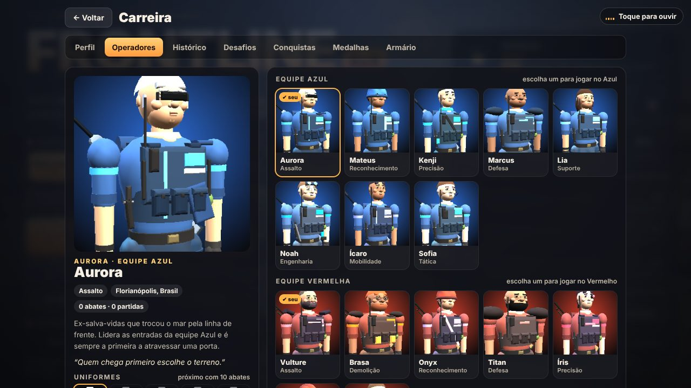
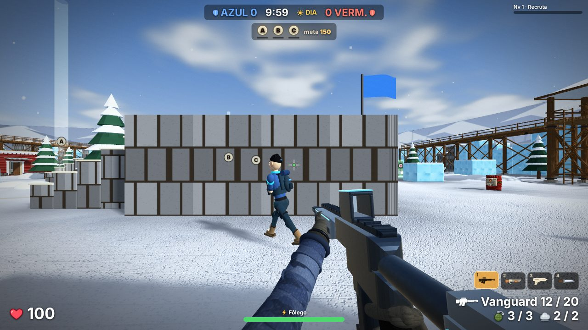
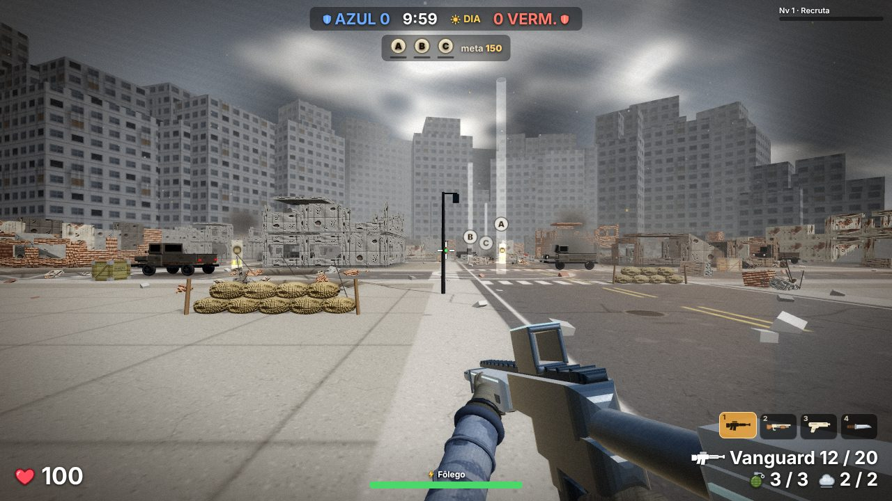
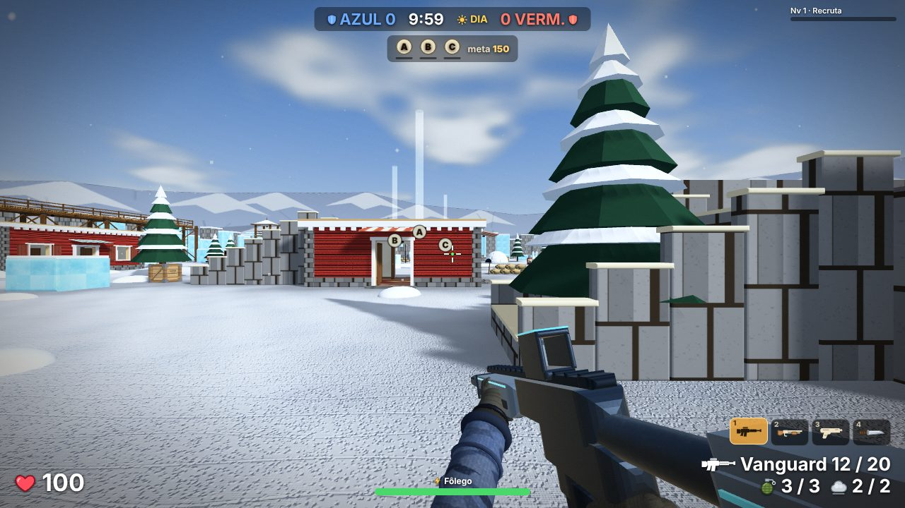
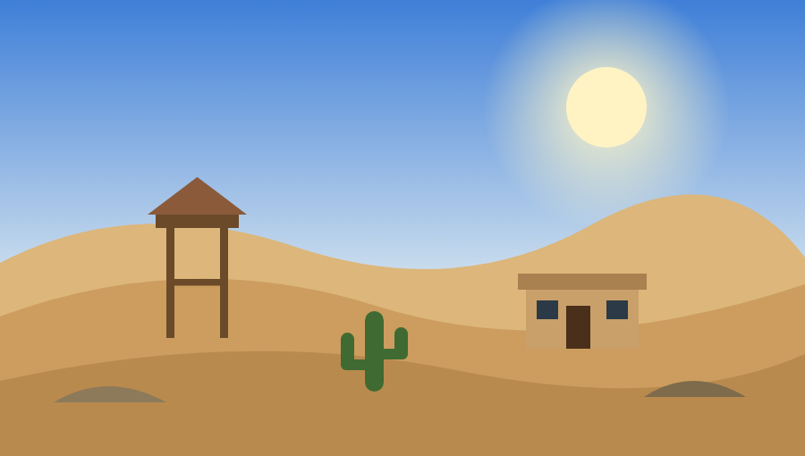
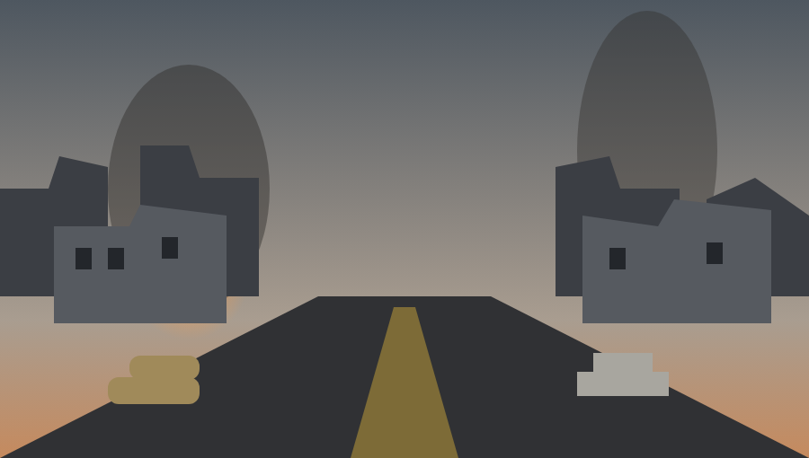
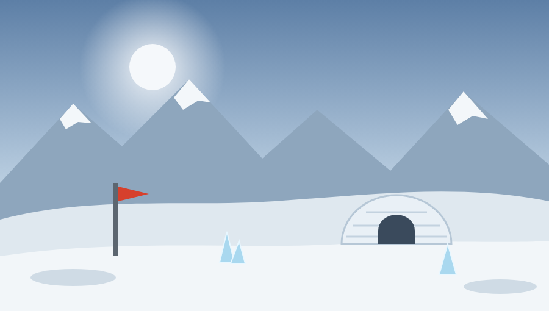

<div align="center">

# 🎯 Frontline 5v5
### Tiro em primeira pessoa no navegador

**5 contra 5, contra bots ou com amigos online.** Sem instalar nada, no computador ou no celular.

[](https://Arabiano0301.github.io/frontline-5v5/)


</div>

---

## ✨ O que tem dentro

- 🔵 **5 contra 5:** jogue com 4 aliados contra 5 inimigos. Os bots têm **4 dificuldades** (Fácil, Médio, Difícil e Extremo): quanto mais alta, mais eles conhecem o mapa, trabalham em equipe e aprendem com a última morte.
- 🎮 **5 modos de jogo**, cada um com regras, duração e vitória próprias:
  - **Mata-mata em equipe:** primeira equipe a 50 abates ou quem liderar em 10 min.
  - **Todos contra todos:** cada um por si, primeiro a 25 abates.
  - **Dominação:** capture e segure os pontos A, B e C.
  - **Eliminação:** rodadas sem renascimento; primeira equipe a 4 rodadas.
  - **Treino:** sem tempo nem placar, para praticar contra os bots.
- 🌐 **Multijogador online:** crie uma sala, mande o código ou o link e jogue com até 10 pessoas. Os amigos podem ficar na mesma equipe e as vagas que sobram viram bots, quantos você quiser em cada lado. A sala tem chat, botão "Estou pronto", ping, regras de duração e meta e convite pelo WhatsApp.
- 🗺️ **Três mapas** (ou deixe o jogo sortear):
  - **Deserto:** dunas, túneis, torres de vigia e passarelas.
  - **Guerra:** cidade devastada, com avenidas, prédios em ruínas e barricadas.
  - **Gelo:** base polar com iglus, cristais de gelo e neve caindo.
- 🔫 **Arsenal:** rifle **Vanguard 7.62**, espingarda **Breach 12**, pistola **Silverline 9**, faca **Wayfarer**, granadas e fumaça.
- 🏃 **Movimento:** correr (gasta fôlego), agachar, pular e rasteira. Suba as escadas das torres para atirar de cima.
- 👁️ **Câmera em 1ª, 2ª ou 3ª pessoa**, escolhida em Configurações.
- 👤 **Operadores:** 15 personagens com biografia, especialidade e **5 uniformes**, liberados por maestria (abates jogando com cada um).
- 🏆 **Carreira:**
  - XP por partida e nível de jogador.
  - **Patente competitiva** de Bronze a Lenda. Só sobe com vitórias e bom desempenho, e cada dificuldade de bots tem um teto.
  - Estatísticas, histórico das últimas 30 partidas e 20 medalhas.
  - 18 conquistas e desafios diários e semanais.
- 🎨 **Armário:** camuflagens de arma, emblemas e títulos. Tudo é só visual, nada dá vantagem em combate.
- 📊 **Pós-partida detalhado:** placar com pontos e assistências, destaques da partida, XP ganho e patente.
- 🔊 **Áudio:** sons novos e música no menu, com volume separado para efeitos e música.
- ⚙️ **Ajustes:**
  - Teclas configuráveis e layout dos botões de toque.
  - Qualidade gráfica, escala de resolução, limite de FPS, sombras, brilho e cor e tamanho da mira.
- 📱 **Celular:** controles de toque, limite de 60 FPS e sombras leves para não esquentar (gire o aparelho para o modo paisagem).

## 🖼️ Telas

<div align="center">





</div>

## 🗺️ Mapas

<div align="center">



</div>

## 🎮 Controles (computador)

Todas as teclas podem ser trocadas em **Controles**.

| Tecla | Ação |
|---|---|
| `W` `A` `S` `D` ou setas | mover |
| `Shift` | correr (gasta fôlego) |
| `C` ou `Z` | agachar (correndo = rasteira) |
| `Espaço` | pular |
| Mouse esquerdo / direito | atirar / mirar |
| `R` | recarregar |
| `1` `2` `3` `4` | rifle, espingarda, pistola, faca (`V` também puxa a faca) |
| `Q` / roda do mouse | última arma / trocar de arma |
| `G` ou `5` | granada |
| `F` ou `6` | granada de fumaça |
| `Tab` (segurar) | placar |
| `Enter` ou `T` | chat (no multijogador) |
| `Espaço` ou `R` | renascer |
| `Esc` | pausa |

Na escada das torres, fique de frente para ela: `W` sobe e `S` desce.

## 🚀 Como jogar

- **Online:** clique no botão **Jogar agora** acima.
- **No computador:** baixe o repositório e abra o `index.html`. **É preciso estar conectado à internet** para carregar o Three.js.
- **No celular:** abra o link, gire para paisagem e toque em **Jogar**.
- **Com amigos:** toque em **Multijogador**, crie uma sala e mande o código ou o link. Quem cria a sala é o anfitrião: a partida roda no aparelho dele, então ele deve usar o aparelho mais forte e manter o jogo aberto na tela.

## 🔒 Privacidade e segurança

- Seu progresso (nível, carreira, patente, itens, ajustes e teclas) fica **só no seu navegador** (`localStorage`). Nada é enviado para servidor nenhum.
- Conexões externas:
  - **Three.js r128**, carregado do CDN `cdnjs.cloudflare.com`.
  - **Só no multijogador:** a biblioteca **PeerJS 1.5.4** (também do `cdnjs`) e o servidor público de salas `0.peerjs.com`, que apenas apresenta os aparelhos. Depois disso, os dados da partida vão direto entre os jogadores (WebRTC).
- No multijogador, os outros jogadores da sala veem o seu nome, emblema, título e operador.
- O `index.html` traz uma **Content-Security-Policy** que só aceita scripts do próprio arquivo e do `cdnjs`, e só se conecta ao servidor de salas.

## 🧱 Tecnologia

Um único arquivo `index.html` (cerca de 670 KB) em **HTML + CSS + JavaScript puro**, com gráficos 3D em **Three.js**, áudio gerado com **Web Audio** e sem etapa de build.

```
frontline-5v5/
├── index.html        # o jogo inteiro
├── docs/img/         # imagens do README
├── LICENSE           # MIT
├── SECURITY.md
└── README.md
```

## 🤝 Contribuindo

Achou um bug ou tem uma ideia (mapa novo, arma, modo de jogo)? Abra uma [issue](../../issues) com o dispositivo e o navegador usados.

## 📄 Licença

[MIT](LICENSE) © 2026 Arabiano0301
