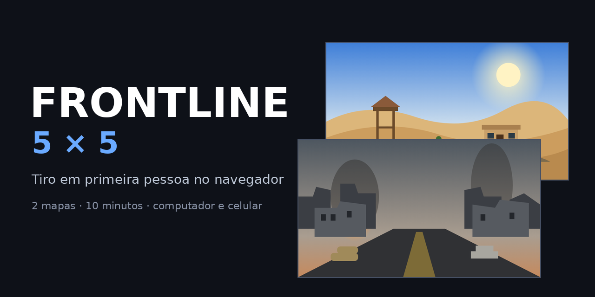

<div align="center">

# 🎯 Frontline 5v5
### Tiro em primeira pessoa no navegador

**Você e 4 bots contra 5 bots, em partidas de 10 minutos.** Sem instalar nada, no computador ou no celular.

[](https://Arabiano0301.github.io/frontline-5v5/)




</div>

---

## ✨ O que tem dentro

- 🔵 **5 contra 5:** você joga no time **Azul** com 4 bots contra 5 bots **Vermelhos**. Vence quem eliminar mais inimigos em **10 minutos**.
- 🗺️ **Dois mapas** (ou deixe o jogo sortear um):
  - **Deserto:** dunas, túneis, torres de vigia e passarelas.
  - **Guerra:** cidade devastada, com avenidas, prédios em ruínas e barricadas.
- 🔫 **Arsenal:** pistola, **rifle HK416**, **espingarda CBC**, faca, **granadas** (3) e **fumaça**. Os bots também alternam entre as armas.
- 🏃 **Movimento:** correr (gasta fôlego), agachar, pular e rasteira. Suba as escadas das torres para atirar de cima.
- 💥 **Cenário vivo:** barris vermelhos explodem, caixas quebram, e os kits reabastecem você (**verde** = vida, **amarelo** = munição).
- ⭐ **Progressão:** nível, XP, títulos, contagem de eliminações e **missão do dia**.
- ⚙️ **Ajustes:** teclas configuráveis e **qualidade gráfica adaptativa**, que reduz a resolução se o FPS cair.
- 📱 **Celular:** controles de toque (gire o aparelho para o modo paisagem).

## 🗺️ Mapas

<div align="center">


</div>

<!--
Quer adicionar prints da partida? Tire 2 ou 3 capturas de tela jogando, envie para a pasta docs/img
(no GitHub: Add file > Upload files) e cole aqui, trocando o nome do arquivo:

<div align="center">


</div>
-->

## 🎮 Controles (computador)

| Tecla | Ação |
|---|---|
| `W` `A` `S` `D` | mover |
| `Shift` | correr (gasta fôlego) |
| `Z` / `Shift` + `Z` | agachar / rasteira |
| `Espaço` | pular |
| Mouse esquerdo / direito | atirar / zoom |
| `E` | recarregar |
| `N` | faca / última arma |
| `B` | trocar de arma: pistola → rifle HK416 → espingarda CBC |
| `U` | granada |
| `R` | renascer |

Na escada das torres, fique de frente para ela: `W` sobe e `S` desce.

## 🚀 Como jogar

- **Online:** clique no botão **Jogar agora** acima.
- **No computador:** baixe o repositório e abra o `index.html`. **É preciso estar conectado à internet** para carregar o Three.js.
- **No celular:** abra o link, gire para paisagem e toque em **Jogar**.

## 🔒 Privacidade e segurança

- Seu progresso (nível, missão do dia, ajustes e teclas) fica **só no seu navegador** (`localStorage`). Nada é enviado para servidor nenhum.
- A única conexão externa é o carregamento do **Three.js r128**, a partir do CDN `cdnjs.cloudflare.com`.
- O `index.html` traz uma **Content-Security-Policy** que só aceita scripts do próprio arquivo e desse CDN.

## 🧱 Tecnologia

Um único arquivo `index.html` (cerca de 330 KB) em **HTML + CSS + JavaScript puro**, com gráficos 3D em **Three.js**
e sem etapa de build.

```
frontline-5v5/
├── index.html        # o jogo inteiro
├── docs/img/         # imagens do README
├── LICENSE           # MIT
├── SECURITY.md
└── README.md
```

## 🤝 Contribuindo

Achou um bug ou tem uma ideia (mapa novo, arma, modo de jogo)? Abra uma [issue](../../issues) com o dispositivo e o navegador usados.

## 📄 Licença

[MIT](LICENSE) © 2026 Arabiano0301
